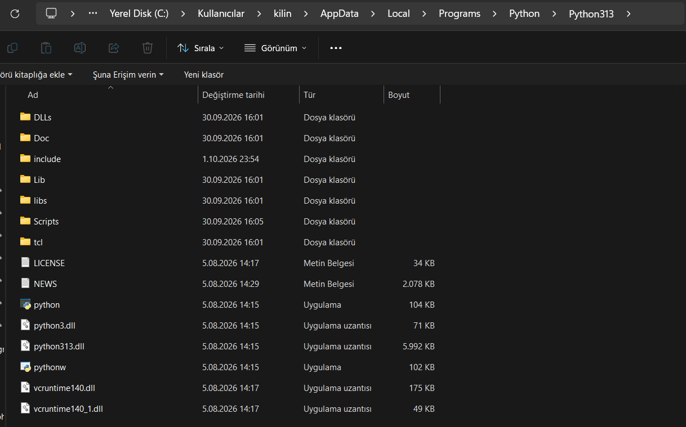

# Python Dosya Yapısı ve IDLE'ın Konumu

## 1. Neden Python'ı Çoğunlukla Başlat Menüsünden Arayarak Açabiliyoruz?
* **Gizli Klasör Kurulumu:** Python, Windows'ta yönetici izni sorunları yaşamamak için genellikle `C:\Users\<Kullanıcı>\AppData\Local\Programs\Python` dizinine kurulur. `AppData` gizli bir klasör olduğu için Dosya Gezgini'nden doğrudan tıklayarak bulmak zordur.
* **PATH Değişkeni Eksikliği:** Kurulum sırasında *"Add python.exe to PATH"* seçeneği işaretlenmediyse, komut satırı veya "Çalıştır" kutusu Python'ın yerini bilemez.
* **Başlat Menüsünün Mantığı:** Başlat menüsü programların ham dosyalarını değil, arka planda oluşturulan `.lnk` uzantılı kısayolları tarar. Bu kısayolların içinde dosyanın tam adresi hazır olarak kayıtlı olduğu için Başlat menüsünden aratıldığında hemen açılır.

---

## 2. Python Dosya Sistemi Nasıl Biçimlenmiştir?
Python tek bir büyük program dosyası değildir; bir yorumlayıcı motor ve kütüphanelerden oluşan modüler bir yapıya sahiptir:
* **`python.exe`:** Konsol tabanlı ana yorumlayıcıdır. Çalıştığında arkasında siyah bir terminal penceresi açar.
* **`pythonw.exe`:** Grafik arayüzlü (GUI) programlar içindir. Pencereli uygulamaları arkada siyah terminal penceresi açmadan, sessizce çalıştırmaya yarar.
* **`Lib/`:** Python'ın tüm standart kütüphanelerini tutan ana klasördür.
  * Harici kütüphaneler (`pip` ile indirilenler) bu klasör altındaki `site-packages/` dizinine gider.
  * IDLE'ın kaynak kodları da yine bu klasörün içindeki `idlelib/` altındadır.
* **`Scripts/`:** `pip.exe` gibi komut satırı araçlarının bulunduğu yerdir.
* **`DLLs/` ve `tcl/`:** Arayüz çizimi (Tkinter) ve sistem işlemleri için gereken C tabanlı kütüphanelerdir.

---

## 3. Ana Klasörde Neden `idle.exe` Yok / Görünmüyor?

> *Görsel: Python ana kurulum dizini incelendiğinde bağımsız bir `idle.exe` dosyasının yer almadığı görülmektedir.*

* **IDLE Ayrı Bir `.exe` Değildir:** Word veya Chrome gibi derlenmiş bağımsız bir program olmadığı için kök dizinde `idle.exe` diye bir dosya bulunmaz.
* **IDLE Bir Python Paketidir:** IDLE bizzat Python ve Tkinter arayüz modülüyle yazılmış bir Python betiğidir. Dosyaları kök dizinde değil, `Lib/idlelib/` klasörü altındadır.
* **Arka Planda Nasıl Çalışır?** Başlat menüsündeki IDLE simgesine tıkladığımızda Windows aslında `pythonw.exe` motorunu çağırır ve ona `idlelib` modülünü açmasını söyler (`pythonw.exe -m idlelib.idle`). Konsol açılmadan doğrudan IDLE ekranının gelme sebebi budur.

---

## Kaynakça
* [Python Software Foundation: Using Python on Windows](https://docs.python.org/3/using/windows.html)
* [Python Software Foundation: IDLE — Python GUI Development Environment](https://docs.python.org/3/library/idle.html)
